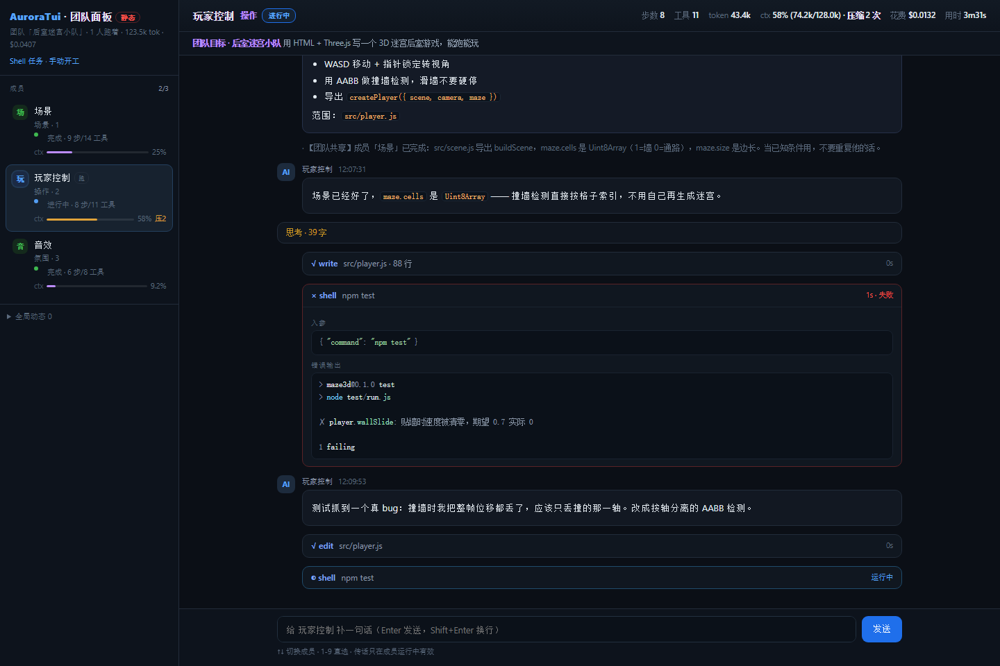

# AuroraTui — 终端里的 AI 编程代理

[](LICENSE)
[](https://nodejs.org)
[](package.json)
[](test/run.js)

一个零依赖的 Node.js TUI Agent：在终端里跑，长得像 Claude Code，干活像 pi；能让一队 AI 并行干活，并在浏览器里逐个看队员的完整对话。启动后先看到 **AuroraTui** 欢迎屏。
四个基础工具（read / write / edit / shell）+ 进阶能力（联网、billion-context 上下文压缩、源码导航、待办、记忆、只读 git、任意 HTTP）。
还能让它**派子代理**或**组队并行开发**（默认关闭，`/subagents on`、`/team on` 手动开）：团队最多 10 个成员，浏览器里是对话式的**团队面板**。

```
◆ AuroraTui v2.0 │ DeepSeek │ 工作区  ~/projects/auroratui
  ● 帮我把 shell 工具的超时改成 60 秒，然后跑一遍测试
    → edit src/tools/shell.js
    √ edit 12ms   +1 -1
    改好了，超时默认值 60s，测试全绿。
╭─ Enter 发送 · Ctrl+J 换行 · ↑ 历史 · / 命令 · Ctrl+C 退出 ─────────────────────╮
│ > /mo                                                                        │
│ ╭─ 1 个命令 · ↑↓ 选择 · Tab 补全 · Esc 关闭 ─────────────────────────────────╮ │
│ │ → /model    [筛选|provider/model]  切换模型（打开选择器）                  │ │
│ ╰───────────────────────────────────────────────────────────────────────────╯ │
╰──────────────────────────────────────────────────────────────────────────────╯
 ● 就绪  ·  ctx 12%  ·  ↑8.4k ↓2.1k  ·  $0.0047       DeepSeek · deepseek-v4.1 · think:off
```

## 安装

```bash
# 1) 依赖：Node.js >= 18（零 npm 依赖）
node -v

# 2) 全局安装（推荐）
npm i -g auroratui      # 也可以 npm i -g <本仓库目录>
auroratui               # 启动 TUI

# 3) 或者直接用仓库
node bin/agent.js
```

> 装完命令叫 `auroratui`，同时保留 `agent` 这个别名（老习惯不用改）。

Windows 提示：TUI 需要**原生控制台**。在 Git Bash / mintty / 管道里运行 `auroratui` 时，启动器会自动弹出一个新的控制台窗口，**窗口标题就是 `AuroraTui`**（当前窗口不是 TTY 时）。
想获得最好的符号显示效果，建议用 [Windows Terminal](https://github.com/microsoft/terminal)；传统 conhost 只支持 ASCII + 制表符，本程序已自动降级（不用 emoji、不用 braille）。

## 用法

```bash
auroratui                      # 打开交互界面
auroratui --demo               # 用一段示例对话预览界面（不联网、不需要 key）
auroratui "帮我修一下这个报错"   # 一次性执行（非交互，可管道）
auroratui --continue           # 恢复上次会话
auroratui --provider deepseek --model deepseek-v4-pro
auroratui --cwd ../other-repo  # 指定工作目录
auroratui --help               # 全部参数
```

### 交互界面快捷键

| 按键 | 作用 |
| --- | --- |
| Enter | 发送（以 `/` 开头时先执行命令补全） |
| Ctrl+J / Alt+Enter | 输入框内换行（多行提示） |
| ↑ / ↓ | 命令补全导航，或调用历史输入 |
| Tab | 补全选中的命令 / 参数 |
| Esc | 关闭补全、清空输入；运行中则中断 Agent |
| Ctrl+C | 退出 |
| Ctrl+U / Ctrl+K / Ctrl+W | 删到行首 / 行尾 / 删一个词 |
| 鼠标滚轮 | 滚动对话（AI 正在输出时也能滚：滚上去就**暂停跟随**，新内容不会把视线拽回底部） |
| Ctrl+End / Ctrl+Home | 跳回最新输出（恢复跟随）/ 跳到最顶部（Home/End 留给输入框光标） |
| 鼠标拖选 | 选中对话文字，松手自动进剪贴板（提示「已复制选区 N 字符」） |
| 鼠标点块头 / 右侧滑块 | 折叠或展开思考块、工具块；拖动右下角滑块滚动长对话 |
| Ctrl+O | 展开/收起最后一个可折叠块（思考、工具输出、超长回答） |
| Ctrl+T | 显示/隐藏思考块正文 |
| Ctrl+V / 鼠标右键 | 把剪贴板内容粘进输入框（多行保留）；剪贴板里是**截图**时，自动存成临时 PNG 并把图片路径填进输入框 |
| Ctrl+V / 鼠标右键（AI 反问你时） | 同一个弹层的自定义输入行里也能粘贴：Ctrl+V、Ctrl+Shift+V、终端自己的右键菜单、鼠标右键，四条路都通；剪贴板是截图时同样把图片路径填进去 |
| /native | 关掉应用内鼠标上报，改用终端自己的选择/复制 |

> 中文输入法：上屏的那一下回车不会被当成「发送」（多字符文本事件后 120ms 内的回车直接忽略），再按一次回车才发送。

### 界面细节

- **AuroraTui 欢迎屏**：点阵 logo + 工具/命令速查（窗口窄于 52 列时自动退化成文字版）。
- **实时用时**：状态栏中间一直跳「用时 12.3s」，任务结束定格成这次的总用时，并留一行 `用时 12.3s · 3 步`。
- **暂停跟随**：滚轮往上滚 / 拖右侧滑块 / PgUp，标题栏右侧出现 `↕N 暂停跟随`，AI 边写边加行视口也不动；滚回底部或按 End 恢复跟随。只有你发新消息时才会自动回到最新。
- **任务标题**：每给一个新任务，标题栏右侧引号里的任务名就换成新的；`/history` 里仍然用每个会话的**第一个**任务做名字，方便区分。
- **思考块**：思考时是黄色 `Thinking… 1.2s`，结束后收成一行 `↓ Thought for 3.2s`，点一下（或 Ctrl+O）展开。
- **工具块**：成功的调用默认只留一行摘要（`√ shell node --test` + 可展开提示），失败自动展开。
- **Markdown 渲染 + 语法高亮**：回复里的标题、列表、表格、引用、行内代码、链接都会排版；代码块用 `╭─ rust · 12 行 ─╮` 边框包起来，支持 js/ts/json/python/bash/c/cpp/java/go/rust/cs/kotlin/swift/dart/ruby/php/lua/sql/yaml/toml/css/html/diff 等着色（未知语言原样显示）。
- **自动续写**：单次输出撞到长度上限时自动让模型从断点接着写（最多 4 次，界面提示「已达单次输出上限，自动续写（第 N 次）」）。
- **AI 反问你**：模型不确定你的意图时会调 `ask` 工具弹选项，单选/多选都行，选项不合适就直接在下面那行输入自己的答案（**能粘贴**：Ctrl+V / Ctrl+Shift+V / 右键 / 终端自己的右键菜单），回答完它继续干活。

### 斜杠命令

| 命令 | 说明 |
| --- | --- |
| `/model [筛选]` | 切换模型（选择器；右下角实时显示当前模型） |
| `/provider …` | 自定义服务商：`list` / `add <id> <baseUrl> [名称]` / `rm <id>` / `key <id> <key>` / `model <id> <模型…>` / `models <id>` |
| `/key [provider] [key]` | 配置 API key（写入 `~/.agent/config.json`，0600） |
| `/think <off\|low\|medium\|high\|max>` | 思考强度，**越低越快**（默认 off） |
| `/new` `/clear` | 新会话 / 只清屏 |
| `/compact` `/expand <ref>` `/ctx` | 手动压缩上下文 / 展开压缩块 / 查看占用 |
| `/cost` | 本会话 token 与花费 |
| `/tools` | 工具清单 |
| `/todo` `/memory` | 查看待办 / 长期记忆 |
| `/verbose` | 工具输出预览 详细↔精简 |
| `/sessions` `/resume <n>` | 会话列表 / 恢复 |
| `/history [筛选]` | 历史对话面板：↑↓ 选择、Enter 恢复、`d` 删除、输入即筛选 |
| `/trust [on\|off]` | 全权模式：允许 Agent 改工作区以外的文件（默认关闭，标题栏显示「全权」徽章） |
| `/undo [n]` | 回滚最近第 n 个检查点（write/edit 前自动备份） |
| `/copy [n]` | 复制最近第 n 条回答 |
| `/paste` | 直接粘贴剪贴板（剪贴板里是截图 → 存成临时 PNG 并填入图片路径） |
| `/skill [list\|load <名>]` | 查看 / 载入技能（`<项目>/.agent/skills/<名>.md` 或 `~/.agent/skills/<名>/SKILL.md`） |
| `/hooks` | 查看已配置的生命周期 hook |
| `/subagents [on\|off]` | 子代理：允许 AI 派一个独立上下文的助手（**默认关闭**，会额外花 token） |
| `/team [on\|off]` | 团队协作：允许 AI 组队、给每个成员分一块开发任务（**默认关闭**，更费 token） |
| `/progress [open]` | 团队面板：浏览器里逐个成员看他的完整对话（`open` 顺手打开浏览器） |
| `/help` `/quit` | 帮助 / 退出 |

> 状态栏组成：`状态 · 用时 · ctx% · ↑输入 ↓输出 · $花费 · 工具调用数` ｜ 右侧 `服务商 · 模型 · think:强度`。

## 工具

**基础四件套**（和 Claude Code 一致）

| 工具 | 说明 |
| --- | --- |
| `read` | 读文件（带行号、分段、目录列表、相似文件名提示）；**也能读图片**——png/jpg/jpeg/gif/webp/bmp 会把图片直接交给模型看（需要模型支持识图），上限 6MB |
| `write` | 写/覆盖文件，自动建目录 |
| `edit` | 精确替换：`old_string`/`new_string`，支持 `edits[]` 批量 + 缩进容错 |
| `shell` | **持久化** bash 会话（cwd / 环境变量跨命令保留），带超时与自动重启 |

**源码导航**：`glob`（按模式找文件）、`grep`（正则搜内容，优先用 ripgrep）、`ls`（目录树）、`think`（写中间推理）

**联网**：`web_search`（DeepSeek/Tavily/Brave/Exa/SearXNG/DDG/Bing 依次回退）、`web_fetch`（网页→Markdown）、`http_request`（任意 HTTP API）

**记忆与上下文**：`todo`（`<项目>/.agent-todo.json`）、`memory`（`~/.agent/memory.json`，跨会话自动注入）、`context`（billion-context）

**只读 git**：`status` / `log` / `diff` / `show` / `blame` / `branches`

**浏览器渲染**：`browser`（复用已装的 Edge/Chrome 无头模式：`open` 取渲染后的 Markdown、`screenshot` 存图，零依赖）

**技能**：`skill`（`list` / `load`，把 `SKILL.md` 里的流程按需读进上下文）

**绘画**：`draw`（像素画板插件，见下一节）

**子代理 / 团队**（默认关闭，见下一节）：`subagent`、`team`

### 画图：draw（不需要图像生成模型）

模型不会画图也能画。`draw` 插件把「像素画板」交给 AI：它输出一串**绘图操作 JSON**（`ops`），本程序用纯 Node 在本地栅格化成像素、编码成 PNG，**并且这张 PNG 会作为图片直接挂进这次工具结果**（`meta.images`）。所以识图模型下一步就**真的看见**了自己画的画，觉得不对就再调一次 `draw` 改，形成 画 → 看 → 改 的闭环。

```
> 画一个史莱姆图标，32×32，放 assets/slime.png
```

- **18 个起手配方**（`stamp`）：`penguin slime cat bird ghost humanoid sword shield potion gem chest tree mushroom star heart coin spark scene` —— 先贴一个，再用 op 改细节。
- **op**：`fill_ellipse` / `fill_rect` / `fill_poly` / `line` / `pixel` / `ellipse` / `rect` / `flood_fill` / `gradient` / `spray` / `outline_in` / `outline_out` / `mirror_x` / `mirror_y` / `margin` / `shift` / `erase` / `clear` / `palette`。
- **锚点相对坐标**：op 里给 `"anchor":[x,y]`，则该 op 的坐标都按偏移算，方便整体挪。
- **画板按名字持久化**（`~/.agent/draw/<name>.json`），跨调用接着改；`undo` 可回退 6 步。
- **诊断**：每次返回包围盒、左右对称度、配色占比、孤立像素坐标，还会直接说「主体贴边了 / 颜色太多了 / 主体太小了」，模型照着改。
- **看细节**：`scale:4~8` 用最近邻放大导出（像素画放大不糊）；`crop:{x,y,w,h}` 只导出局部一块（配 `scale:12` 看 1~2px 的眼睛），画板本身不变；也可以照旧 `read` 那个 PNG。
- **颜色**支持 `#rgb` / `#rrggbb` / `#rrggbbaa`（8 位带透明度，半透明阴影不会再被当死黑）。
- **有背景时的诊断**：填了渐变/底色后整幅包围盒天然贴边，工具会把背景色单独判出来，只对「主体」报贴边/太小。
- 详细用法写在技能里：`skill load draw`（`~/.agent/skills/draw.md`）。

**下边这些图全部是这个插件在本地画出来的**（不是 AI 生图，是 AI 算坐标 + 纯 Node 栅格化 + zlib 编码，零依赖，毫秒级）：

<p align="center"></p>

18 个起手配方，模型只需要改细节就能出成品：

| 角色 | | 道具 | |
| --- | --- | --- | --- |
| [企鹅](docs/drawings/penguin.png) | [史莱姆](docs/drawings/slime.png) | [剑](docs/drawings/sword.png) | [盾](docs/drawings/shield.png) |
| [猫](docs/drawings/cat.png) | [小鸟](docs/drawings/bird.png) | [药水](docs/drawings/potion.png) | [宝石](docs/drawings/gem.png) |
| [幽灵](docs/drawings/ghost.png) | [人形](docs/drawings/humanoid.png) | [箱子](docs/drawings/chest.png) | [树](docs/drawings/tree.png) |
| [蘑菇](docs/drawings/mushroom.png) | [场景](docs/drawings/scene.png) | [星星](docs/drawings/star.png) | [心](docs/drawings/heart.png) |
| | | [金币](docs/drawings/coin.png) | [火花](docs/drawings/spark.png) |

图片在 [`docs/drawings/`](docs/drawings/)（源码与重生成脚本一起放在仓库里，随时能重画）。

插件在启动时自动加载（`settings.plugins = false` 可整体关掉）；要求模型支持识图，纯文本模型看不见画面但照样能画，只是得靠 ASCII 预览和诊断来改。

### 子代理与团队协作（默认关闭，会额外花 token）

这两个能力默认是**关**的——关着的时候 AI 的工具清单里根本没有它们，系统提示里也只会写一句「玩家没开，需要就用 `/subagents on`、`/team on`」，所以不会偷偷烧 token。开着的时候，系统提示会额外注入一段用法与纪律（什么时候该派、什么时候自己干更快）。

```bash
/subagents on    # 允许派「子代理」：独立上下文的下属，只把结论带回来
/team on         # 允许组「团队」：多个成员各领一块活，并行开发
/progress        # 起一个本地团队面板，浏览器里看每个成员的完整对话
```

**`subagent` —— 一个下属**

| 参数 | 说明 |
| --- | --- |
| `task` | 必填，要它干什么（越具体越好，它看不到主对话） |
| `role` | 可选人设，如「测试工程师」「安全审计员」 |
| `name` | 可选代号，界面上显示成 `subagent · 代号` |
| `tools` | 可选白名单，默认给全套开发工具；只读调查可以传 `["read","grep","glob","ls"]` |
| `model` | 可选，让它用更便宜/更快的模型跑 |
| `max_steps` | 可选，最多几步就收工（默认 `settings.subagentMaxSteps`） |

适合的活：大范围搜索、跑测试并总结失败原因、读一堆文件提炼结论、写一个独立小模块。子代理只把**结论**带回主对话（工具细节留在它自己的上下文里），主对话因此更干净——这也是它省钱的地方，但一次派单本身要花 token，所以简单任务它会自己做。

细节：子代理不能再派子代理（层数由 `settings.subagentDepth` 限，默认 1），也不能用 `ask` / `subagent` / `team` / `plugin` / `context`；有超时保护（`settings.subagentTimeout`，默认 600s），`Ctrl+C` 会一起中断。

**`team` —— 一个小队**

| action | 说明 |
| --- | --- |
| `create` | 建队并开工：`goal` + `members[{name, role, task, files, model, tools}]`，最多 **10** 个成员，`concurrency` 默认 2（上限 10），`open_dashboard` 顺手打开团队面板 |
| `status` | 看谁跑完了、谁在干什么、花了多少 |
| `wait` | 停下来等，`timeout_sec` 默认 120，超时会报当前进度 |
| `report` | 每个成员的产出摘要（拿来合并、评审） |
| `say` | 给某个**还在跑**的成员插话（纠偏：「别动 migrations/」） |
| `stop` | 全部叫停（已做的改动保留，可 `/undo` 回滚） |

```
> 组个队把 utils 拆成三个模块，顺手补测试

· 团队「拆分utils」开工：3 人 · 并发 2
· 团队面板 http://127.0.0.1:7870/
```

每人是**独立的 Agent + 独立上下文**，互不污染；成员只干自己的那块，主代理负责合并、抽检查和拍板。团队的快照会写到 `<项目>/.agent/team/latest.json`，进程退出后 `team status` / `team report` 仍能回看。

**团队面板（浏览器）**



_左边点谁，右边就是他那一整段对话：任务、思考、每句话、每次工具调用的入参与真实输出、最后的交代。_

- 地址 `http://127.0.0.1:7870/`（端口由 `settings.progressPort` 决定，被占会自动往后找）；只监听本机，进程退出即消失。
- **左边选人，右边就是这个人的一整段对话**：他领到的任务、他的思考、他说的每句话（Markdown 渲染 + 代码高亮）、每一次工具调用的入参和真实输出（失败的自动展开）、最后的交代。不再是流水账式工具日志。
- 键盘 `↑↓` 切成员、`1`~`9` 直达、点一下就换；新内容自动跟到底部，往上滚就暂停跟随。也可以用 `?sel=2` 深链到第 2 个成员。
- **能给还在跑的成员传话**：底下那个输入框（等价于 `team` 的 `say`），一句话纠偏「别动 migrations/」。
- 左下角折叠着「全员动态」，想看全局时间线就展开；顶部有团队名、完成人数、总 token 与花费。
- 失败的工具有红边框并自动展开（入参 + 错误输出全给你看），成功的一行摘要、想细看就点开。
- TUI 里 `/progress` 打印地址，`/progress open` 直接开浏览器；工具块里也会带这条地址。
- 截图/存档：地址后面加 `?still=1` 就不建立 SSE 长连接（headless 浏览器截图时不会卡在加载中）。

```json
{ "settings": {
  "subagents": true, "team": true,
  "subagentDepth": 1, "subagentMaxSteps": 40, "subagentTimeout": 600,
  "teamConcurrency": 2, "teamMaxMembers": 10, "teamMemberTimeout": 1800,
  "progress": true, "progressPort": 7870
} }
```

**时间上限不会“白干”**：成员默认给 `settings.teamMemberTimeout`（1800s，比子代理宽松得多）。到点时先发一条「时间到，别再开新活，用 3-8 行交代你做了什么」让它收尾；再多给 15%（15s~180s）宽限，真不结束才硬中断。所以就算超时，面板和 `team report` 里也能看到他写到哪、哪些文件改了、哪块没做完。

**看截图 / 设计稿**：直接用 `read` 读图片文件，图片会作为图片内容附进对话，模型能真的看到画面（不是 OCR 文字）。工具块里会标 `[图片 1280x720 · 355KB]`。

```
> 看下 D:/Downloads/shot.png，页面为什么错位了？
```

- 支持的格式：png / jpg / jpeg / gif / webp / bmp；单张上限 6MB（超了会提示用 ffmpeg 或 browser 的 screenshot 缩小/重截）。
- **直接粘截图**：Win/PowerShot 之类的截图只在剪贴板里（没有文件）。Ctrl+V / 右键 / `/paste` 会先读文本，读不到就取剪贴板里的图片，存成 `%TEMP%/agent-clip-*.png`，把**路径填进输入框**（终端画不出图，所以走「贴路径」策略），回车发送后模型自己用 `read` 看图。macOS 用 `pngpaste` 或 osascript，Linux 用 `wl-paste`/`xclip`。剪贴板里是「复制了图片文件」时，直接填文件路径。
- 需要**识图模型**（vision）：`deepseek-v4`、`gpt-5.4`、`claude-*-5-5`、`gemini-3-pro`、`kimi-k2.5`、`glm-5` 等都支持；纯文本模型会忽略图片或报错。
- 想省 token：截图前先缩到 1280 宽，一张图约 1100 token。

### 工作区与权限

- 在哪个目录启动 `agent`，那个目录就是**工作区**（标题栏实时显示，`[工作区]` 徽章）。
- 默认只允许在工区内写文件；越界写入会被拒绝并提示执行 `/trust` 打开**全权模式**（徽章变 `[全权]`，再执行一次 `/trust` 关闭）。
- `write` / `edit` 前自动存检查点（`~/.agent/checkpoints/<会话>/`），`/undo` 可回滚。

### 生命周期 hook

在 `~/.agent/config.json` 里加 `hooks`，让外部脚本在工具执行前后介入：

```json
{
  "hooks": {
    "preToolUse": [{ "match": "shell", "command": "node .agent/hooks/guard.js", "block": true }],
    "postToolUse": [{ "match": "write|edit", "command": "npx prettier --write" }]
  }
}
```

脚本从 stdin 拿到 `{event, tool, input, cwd, session, isError, content}`；**退出码 2 = 拒绝执行**（stderr 作为理由回给模型），stdout 会作为提示附在工具结果里。

### billion-context（上下文压缩）

会话变长后自动把早期历史压成摘要块（阈值默认 72% 上下文窗口），Agent 需要细节时用 `context` 工具：

- `status` — 当前占用、块列表
- `search <关键词>` — 在压缩块里检索
- `expand <b1|m00012-m00040>` — 还原原文
- `compress` — 手动压缩

也可以用 `/compact`、`/expand b1`、`/ctx`。

## 服务商（真实 API 地址）

| ID | 名称 | Base URL | 文档 / Key |
| --- | --- | --- | --- |
| `deepseek` | DeepSeek | `https://api.deepseek.com/v1` | [docs](https://api-docs.deepseek.com) · [key](https://platform.deepseek.com/api_keys) |
| `openai` | OpenAI | `https://api.openai.com/v1` | [docs](https://developers.openai.com/api/docs) |
| `anthropic` | Anthropic Claude | `https://api.anthropic.com/v1` | [docs](https://platform.claude.com/docs) |
| `gemini` | Google Gemini | `https://generativelanguage.googleapis.com/v1beta/openai` | [docs](https://ai.google.dev/gemini-api/docs) |
| `moonshot` | Moonshot Kimi | `https://api.moonshot.cn/v1` | [docs](https://platform.kimi.com/docs/api/overview) |
| `zhipu` | 智谱 GLM | `https://open.bigmodel.cn/api/paas/v4` | [docs](https://docs.bigmodel.cn) |
| `qwen` | 阿里通义千问 | `https://dashscope.aliyuncs.com/compatible-mode/v1` | [docs](https://help.aliyun.com/zh/model-studio/) |
| `xai` | xAI Grok | `https://api.x.ai/v1` | [docs](https://docs.x.ai) |
| `groq` | Groq | `https://api.groq.com/openai/v1` | [docs](https://console.groq.com/docs) |
| `openrouter` | OpenRouter | `https://openrouter.ai/api/v1` | [docs](https://openrouter.ai/docs) · [key](https://openrouter.ai/keys) |
| `siliconflow` | 硅基流动 | `https://api.siliconflow.cn/v1` | [docs](https://docs.siliconflow.cn) |
| `ollama` | Ollama（本地） | `http://127.0.0.1:11434/v1` | [docs](https://github.com/ollama/ollama/blob/main/docs/openai.md) |
| `lmstudio` | LM Studio（本地） | `http://127.0.0.1:1234/v1` | [docs](https://lmstudio.ai/docs/app/api/endpoints/openai) |
| `custom` | 任意 OpenAI 兼容 | 自定义 | 在界面里 `/provider add` |

### 添加自定义服务商（玩家自定义）

任何 OpenAI 兼容的网关（自建、局域网、中转）都可以挂进来，只存在你本机的 `~/.agent/config.json`，不会进仓库。

界面里直接用命令：

```
/provider add mygw http://192.168.1.9:8000/v1 我的网关
/provider key mygw sk-xxxxxx
/provider model mygw my-model-a my-model-b
/model mygw/my-model-a          # 直接切换
/provider models mygw           # 拉取 /v1/models 看看有哪些
```

或直接编辑 `~/.agent/config.json`（`customProviders` 字段）。

## 配置

- `~/.agent/config.json` —— 服务商、密钥（0600）、默认模型、思考强度、压缩阈值
- `~/.agent/memory.json` —— 长期记忆（`memory` 工具维护）
- `~/.agent/sessions/` —— 会话快照（`/sessions` 恢复）
- `~/.agent/logs/` —— `crash.log`（异常）、`launch.log`（`AGENT_DEBUG=1` 时）
- `<你的项目>/.agent-todo.json` —— 当前项目的待办
- `<你的项目>/.agent/team/latest.json` —— 最近一次团队的进度快照（`team status` / `report` 回看用）
- `<你的项目>/MEMORY.md` —— 可选，项目记忆，会自动注入系统提示

环境变量可作为密钥兜底：`DEEPSEEK_API_KEY`、`OPENAI_API_KEY`、`ANTHROPIC_API_KEY`、`GEMINI_API_KEY`、`MOONSHOT_API_KEY`、`ZHIPU_API_KEY`、`DASHSCOPE_API_KEY`、`XAI_API_KEY`、`GROQ_API_KEY`、`OPENROUTER_API_KEY`、`SILICONFLOW_API_KEY`、`TAVILY_API_KEY`、`BRAVE_API_KEY`、`EXA_API_KEY`、`SEARXNG_URL`。
`AGENT_HOME` 可把整个 `~/.agent` 指到别处（测试用）。

## 想让它更快？

1. `/think off`（默认）—— 关掉推理链，首字最快；难题再 `/think low|medium|high`
2. 选更快的模型：`/model flash`（DeepSeek flash、gpt-5.4-mini、gemini-2.5-flash、kimi-k2-turbo…）
3. `/verbose` 关掉工具输出预览，减少重绘
4. 长会话用 `/compact` 或让它自动压缩（上下文越短越快）
5. 流式输出是边到边画（约 45fps 上限），不再等整段返回

## 测试

```bash
npm test                # 离线：引擎 / 工具 / 无头 UI / 布局 / 粘贴 / 协作面板
node test/run.js --live # 额外跑一次真实模型的端到端用例
```

全部是纯 Node 自建的假 TTY 测试，不装任何测试框架。

## 目录结构

```
bin/agent.js         启动器（TTY 检测 → 非 TTY 时在新控制台重启）
bin/agent.cmd|.sh    平台包装脚本
src/agent.js         Agent 主循环（流式、工具调度、自动压缩）
src/llm.js           OpenAI / Anthropic 两种 wire 协议的流式客户端
src/providers.js     服务商与模型注册表（含自定义服务商）
src/config.js        ~/.agent/config.json 读写
src/context/engine.js  billion-context 引擎（压缩 / 检索 / 展开）
src/tools/*.js       fs / shell / web / search / todo / git / context / subagent / team
src/subagent.js      子代理：独立 Agent + 独立上下文，只回结论
src/team.js          团队：成员并行、进度快照、插话与叫停
src/progress.js      团队面板（本地 HTTP + SSE + 内嵌页面，零依赖）
src/ui/app.js        渲染器、输入、命令、选择器、补全
src/ui/{theme,markdown,keys}.js
test/                离线与在线测试
docs/                截图（README 用）
```

## 设计取舍

- **零依赖**：不装任何 npm 包，渲染器、Markdown、SSE、glob/grep 都自己写，启动 < 100ms。
- **持久 shell**：一个 bash 进程贯穿整个会话，`cd`/`export` 都保留，比每次 `spawn` 快得多。
- **只读工具并发**：连续只读调用并行执行，写类工具串行，避免自己打自己。
- **上下文有预算**：工具输出超过预算自动截断（原文仍可 `expand` 找回），历史压缩成摘要块。
- **人类可审查**：`think` 留下推理痕迹，工具调用、diff、花费都在界面上可见。
- **贵的东西要玩家点头**：子代理与团队协作会成倍放大 token 消耗，所以默认关闭、只能 `/subagents on`、`/team on` 手动开；开着的时候面板地址、每步花费都在界面和浏览器里明明白白。
- **看得见才算数**：团队不是“跑完给个总结”。每一步都进了每个成员自己的对话流（工具入参、真实输出、思考、交代），面板里随时能回看——出了问题能一眼看出是哪个成员、哪一步、为什么。
- **画图不靠图像模型**：`draw` 把画面拆成可枚举的绘图操作，模型只需要算坐标；栅格化和 PNG 编码都在本地（纯 Node + zlib），零依赖、毫秒级。画完的图直接回灌进对话，模型靠"看"而不是"猜"来迭代 —— 这比让它一口气生成一张图要可控得多。

## 参与开发

```bash
git clone https://github.com/Mmr-God/auroratui.git
cd auroratui
npm test          # 不用 npm install，本来就没依赖
node bin/agent.js --demo
```

欢迎提 issue / PR：新工具（`src/tools/*.js` 导出 `{name, description, schema, run}`）、新服务商、新插件都可以。

## 协议

MIT（见 [LICENSE](LICENSE)）。

